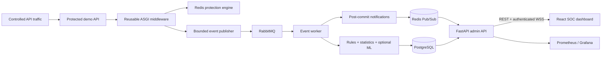

<div align="center">

# 🛡️ SENTINEL AI

### Intelligent API Security & Threat Detection Platform

**Monitor traffic. Enforce protections. Explain threats. Investigate incidents in real time.**

[](https://github.com/satvikpandey21/SENTINEL-AI/actions/workflows/ci.yml)


**[Features](#-key-capabilities) · [Architecture](#-architecture) · [Quick Start](#-run-locally) · [Validation](#-testing--verification) · [Documentation](#-documentation)**

</div>

---

## Overview

**Sentinel AI** is a full-stack, backend-first API security and threat-detection platform built to demonstrate real-world security engineering: distributed request protection, asynchronous event processing, explainable threat analysis, and an authenticated security operations dashboard.

Instead of generating decorative security scores, Sentinel processes **real requests to an owned demo API**, applies **Redis-backed protection policies**, persists events through **RabbitMQ + PostgreSQL**, and surfaces evidence to operators through **FastAPI, REST and authenticated WebSockets**.

> **Project scope:** A security engineering / portfolio system for controlled APIs. It is **not** a turnkey enterprise WAF or an authorization to monitor third-party services. The optional ML component is experimental and never independently blocks traffic.

## ✨ Key Capabilities

| Area | What is implemented |
| --- | --- |
| **API monitoring** | Reusable ASGI middleware; bounded request telemetry with sanitized route, status, timing and HMAC-based client identifiers. |
| **Distributed protection** | Atomic Redis sliding-window rate limiting, verified-login brute-force detection, temporary blocks, configurable policies, observation mode, and explicit outage behavior. |
| **Event pipeline** | Bounded asynchronous publishing → durable RabbitMQ queues → independent worker → idempotent PostgreSQL writes, with retry and redacted dead-letter handling. |
| **Threat analysis** | Explainable 0–100 deterministic scoring, time-windowed behavioral features, robust statistical anomalies, evidence and threat classifications. |
| **Experimental ML** | Versioned scikit-learn Isolation Forest with explicit feature schema and separate evaluation; **advisory only**, disabled by default. |
| **Secure administration** | Argon2id passwords, short-lived JWTs, rotating HttpOnly refresh cookies, CSRF/Origin protection, ADMIN/ANALYST role boundaries and audit trails. |
| **Live operations** | Ticket-authenticated WebSocket notifications, session revalidation, reconnect/reconciliation, unread state and responsive React dashboard. |
| **Observability** | Private Prometheus metrics, **five provisioned Grafana dashboards** and **nine operational Prometheus alert rules**. |
| **Engineering quality** | Docker Compose, Alembic migrations, dependency health checks, CI, integration/browser tests and local HTTPS/WSS deployment acceptance. |

## 🧭 Explore the Dashboard

| Screen | Purpose |
| --- | --- |
| **Security Overview** | Security activity, enforcement signals and current metrics. |
| **Security Events** | Investigate persisted HTTP/decision events with filtering and detail views. |
| **Threat Intelligence** | Review risk assessments, severity, classifications and supporting evidence. |
| **Client Investigation** | Explore pseudonymous client behavior and related findings. |
| **Protection Policies** | Review and manage versioned endpoint protection rules (admin-only changes). |
| **Audit Logs** | Inspect privileged administrative actions (ADMIN). |
| **Settings** | Operator/account workspace settings. |

The notification center is available from the dashboard header. It uses authenticated real-time security messages, not fake or hard-coded alerts.

**Gallery:** We're collecting redacted screenshots from actual controlled demo traffic. See the [screenshot and demo guide](docs/PORTFOLIO_MEDIA_GUIDE.md) for the recommended captures; image links will be added after the real files exist.

## 🏗️ Architecture



**How a request becomes a security finding**

1. The demo API receives a real HTTP request. Middleware records **allowlisted metadata** and executes an atomic Redis policy check.
2. A bounded background publisher transports the sanitized event through RabbitMQ; the independent worker validates and persists it to PostgreSQL.
3. The worker builds behavioral features and explainable assessments using deterministic rules, robust statistics, and optional experimental ML evidence.
4. After committed events, Redis Pub/Sub provides live hints; the authenticated FastAPI admin service streams them through ticketed WebSockets.
5. The React console displays real records and reconciles the authoritative REST data after reconnecting. Prometheus/Grafana provide **private** operational visibility.

**Design choices:** request enforcement is separated from asynchronous event storage; ML does not override deterministic protection; persistence is idempotent and the UI never treats a notification as the source of truth.

For deeper design decisions and operational boundaries, read [Architecture](docs/architecture.md).

## 🧰 Technology Stack

| Layer | Tools |
| --- | --- |
| Dashboard | React, TypeScript, Vite, Playwright |
| APIs and middleware | Python 3.11, FastAPI, ASGI, Pydantic |
| Detection | Deterministic rules, robust statistics, scikit-learn (experimental Isolation Forest) |
| Data | PostgreSQL, SQLAlchemy, Alembic |
| Distributed state | Redis + Lua scripts |
| Event transport | RabbitMQ, background event worker |
| Security | Argon2id, JWT, HttpOnly refresh cookies, CSRF/Origin validation, RBAC |
| Monitoring | Prometheus, Grafana |
| Infrastructure | Docker Compose, Caddy, GitHub Actions |
| Quality | Pytest, Ruff, Vitest, Playwright |

## ⚡ Run Locally

### Prerequisites

- Docker Desktop / Docker Engine running Linux containers, plus Docker Compose.
- Python **3.11** for setup scripts.
- Node.js **22.12+** and npm for the dashboard (Node 24 used in CI).
- Free localhost ports **8000**, **3000**, and **5173**.

Clone the repository:

```bash
git clone https://github.com/satvikpandey21/SENTINEL-AI.git
cd SENTINEL-AI
```

### 1. Initialize the local environment

Run these **once on a fresh checkout** (never commit generated secrets):

```bash
python scripts/init_env.py
python scripts/configure_demo_auth.py --initialize
python scripts/init_env.py --add-admin-key
python scripts/init_observability.py
```

If you already have a configured `.env`, preserve it and do not regenerate credentials. See the [deployment/operations guide](docs/deployment-guide.md) for existing installations.

### 2. Start the backend and infrastructure

```bash
docker compose config --quiet
docker compose up --build -d --wait --wait-timeout 180
docker compose ps
```

### 3. Bootstrap your local admin account

```bash
docker compose exec admin-api python -m sentinel_api.bootstrap --username sentineladmin
```

Follow the **interactive, private password prompt**. Bootstrap only creates the first administrative account and will refuse to overwrite an existing one.

### 4. Start the React dashboard

```bash
cd apps/dashboard
npm ci
npm run dev
```

| Local URL | Purpose |
| --- | --- |
| `http://localhost:5173` | React dashboard |
| `http://localhost:8000/health/ready` | Admin API readiness |
| `http://localhost:3000` | **Local-only** Grafana (credentials are in your ignored secrets) |

The demo API, PostgreSQL, Redis and RabbitMQ are **not publicly exposed** by the default setup.

### 5. Generate controlled security activity

From the **repository root**, request the private, protected demo endpoint:

```bash
docker compose exec -T demo-api python -c "import urllib.request,urllib.error; u='http://127.0.0.1:8000/api/demo/limited'; [(lambda i: print(i, 'HTTP', (lambda: (lambda r: r.status)(urllib.request.urlopen(u,timeout=5)))()))(i) for i in range(1,4)]"
```

You can also use the [verification scripts](docs/day-9-verification.md) and the private demo API to generate a controlled burst that results in **HTTP 429**, then inspect **Security Events**, **Threat Intelligence**, and the **notification center**. Avoid generating traffic against external targets.

> The dashboard has **real authentication**. Do not publish your administrator password, tokens, browser network headers, private `.env` values, or secret files.

## ✅ Testing & Verification

| Verification | Latest reported local result |
| --- | --- |
| Backend unit + integration tests | **421 passed** |
| Backend coverage | **91.56%** |
| Frontend tests | **72 passed** |
| Development browser scenarios | **10 passed** |
| Isolated production HTTPS/WSS browser scenarios | **6 passed** |
| Deployment persistence/fault verification | Passed, including fresh-database recovery and restart durability |
| GitHub Actions | Automated Python, frontend, Docker, security, observability and browser checks |

**CI status:** [Sentinel checks workflow](https://github.com/satvikpandey21/SENTINEL-AI/actions/workflows/ci.yml). These are recorded verification results, **not** promises that all environments behave identically.

Run backend/integration tests from the root (with the local Docker environment initialized):

```bash
docker compose --profile test build
docker compose --profile test run --rm tests
```

Run frontend checks from `apps/dashboard`:

```bash
npm run lint
npm run typecheck
npm run test:coverage
npm run build
```

See [Phase 9 verification](docs/day-9-verification.md) for the detailed local-test evidence, limitations and recovery checks.

## 🔐 Security and Deployment Boundaries

- **Privacy by design:** do not persist raw IPs, request bodies, credentials, cookies or sensitive query strings in security telemetry. Client correlation uses keyed HMAC pseudonyms.
- **Separation of duties:** administrative APIs are authenticated and role-restricted. The production demo login is disabled; production-only credentials stay out of Git.
- **Safe streaming:** WebSocket tickets are short-lived and single-use, with Origin/session validation and bounded resource usage.
- **Protection vs. analytics:** deterministic Redis rules enforce; statistical and **experimental ML** findings are explanatory and never independently block a client.
- **External exposure:** the production-style Caddy configuration publishes only the intended dashboard/admin API. PostgreSQL, RabbitMQ, Redis, metrics and Grafana remain private.
- **Hosting status:** validated on local HTTPS/WSS and demonstrated through a **temporary Cloudflare Quick Tunnel**. There is **no claimed permanent 24/7 public deployment**, no guaranteed tunnel uptime, and no public anonymous admin access.

For secure TLS, backups, environment initialization, rollback and tunnel/VM options, see the [deployment guide](docs/deployment-guide.md).

## 📁 Repository Layout

```text
apps/
  admin-api/             FastAPI security administration
  demo-api/              Owned API workload for protection tests
  event-worker/          Persistent events and asynchronous analysis
  dashboard/             React + TypeScript security operations console
packages/
  sentinel-security/     Reusable ASGI security middleware & engine
infra/
  deploy/                Caddy and production ingress
  observability/         Prometheus / Grafana configuration
  rabbitmq/              Broker configuration
migrations/              Alembic PostgreSQL migrations
scripts/                 Initialization, verification, deployment, backups
tests/
  unit/
  integration/
docs/                    Architecture, contracts and verification evidence
.github/workflows/ci.yml Automated validation pipeline
compose*.yaml            Development and production topology variants
```

## 📚 Documentation

- [Architecture and design decisions](docs/architecture.md)
- [Administrative API contract](docs/admin-api-contract.md)
- [Real-time and security event schema](docs/security-notification-v1.schema.json)
- [Observability and operational dashboards](docs/observability.md)
- [Deployment, recovery and safe tunnel usage](docs/deployment-guide.md)
- [Detailed Phase 9 verification](docs/day-9-verification.md)
- [Screenshot and portfolio demo guide](docs/PORTFOLIO_MEDIA_GUIDE.md)

---

<div align="center">

**Built by [@satvikpandey21](https://github.com/satvikpandey21)**

*An engineering portfolio project focused on transparent security decisions, robust backend systems and repeatable testing.*

</div>
