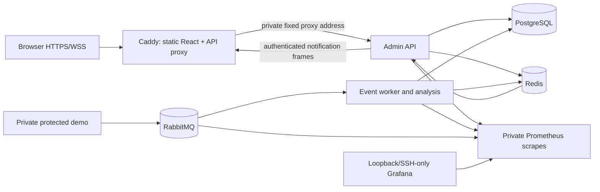

# Deployment guide — Phase 9

This repository deploys the complete Sentinel platform, including its databases, broker,
worker and operational monitoring. Serving React alone is not a complete deployment.
No public endpoint was deployed in this session. Local production-topology HTTPS/WSS was
verified using a private test CA. See [day-9-verification.md](day-9-verification.md) for evidence.

## Local development remains unchanged

Keep the existing `.env`, secrets and named volumes:

```powershell
python scripts/init_observability.py
docker compose up --build -d --wait --wait-timeout 180
cd apps/dashboard
npm.cmd run dev
```

React: http://localhost:5173. Admin API: http://localhost:8000. Grafana:
http://localhost:3000 (`sentinel-ops`, password in the existing ignored secret file).
Prometheus, database and broker ports remain private. No `compose.dev.yaml` is required.
Only if there is no Sentinel administrator, bootstrap interactively:

```powershell
docker compose exec admin-api python -m sentinel_api.bootstrap --username your-admin-name
```

The bootstrap refuses to replace existing accounts and never accepts a password argument.

## Production topology and prerequisites

One Linux host runs Docker Engine and **Docker Compose 2.24.4 or newer**. The `!reset` and
`!override` tags remove development port bindings rather than merging them accidentally.
Use an exact DNS hostname, reachable TCP 80/443, persistent local disk and a user who can
operate Docker. Allow SSH only from your own network. Never expose Docker's API/socket.
A practical small VM has at least 4 GiB RAM; 8–12 GiB gives build/maintenance headroom.
The runtime limits are ceilings, not CPU reservations or a capacity guarantee.



The production override removes the administrative host port. Only Caddy publishes public
80/443; Grafana remains bound to 127.0.0.1:3000 for an SSH-forwarded operator session.
Prometheus, PostgreSQL, Redis, RabbitMQ, demo and worker have no host bindings. The public
proxy serves `/api/admin/*` and the React SPA. `/api/demo/*`, `/metrics*`, private API metrics
and infrastructure health routes are not published. Generate owned demo traffic through
`docker compose exec` on the server, not a public attack endpoint.

Caddy runs as UID/GID 10001, with a read-only root, dropped capabilities, no-new-privileges,
a 256 MiB / 0.5 CPU cap and bounded logs. It binds low ports using a sysctl scoped to its
own network namespace. Its fixed private IP is 172.30.90.2; the admin API trusts only that
/32 for forwarded client addresses. Caddy overwrites incoming `X-Forwarded-For` and removes
`Forwarded`. The reserved internal edge subnet is 172.30.90.0/28: check for host network
conflicts before deployment. Run one production/tunnel/test edge topology per host.

The API enforces production mode, exact HTTPS Origin, Secure HttpOnly SameSite=Strict refresh
cookies and existing JWT/session/RBAC/CSRF rules. Caddy forwards WebSocket upgrades and
preserves Origin. The frontend uses the same-origin `/api/admin` path; no tokens enter
frontend configuration. CSP permits scripts only from the same origin and connections to
the same site/WSS host. Runtime proxy logs delete entire request/header objects; access
logging is disabled. API and WebSocket libraries retain existing sensitive-log redaction.

## Package the current uncommitted implementation

Phases 7–9 are intentionally uncommitted. `git archive HEAD` would omit them. Create a
source release containing current tracked and non-ignored untracked files:

```powershell
python scripts/package_release.py .artifacts/sentinel-phase9-release.zip
```

The archive includes a SHA-256 file manifest, source, locks, migrations and provisioning.
It refuses private environment/secret paths and does not commit or push. Review the archive
and transfer it through an authenticated channel. Keep `.env.production`, secret files,
backups and TLS state separately and privately. On the Linux VM, extract the source into a
versioned release directory. Keep the same explicit Compose project name across releases
so that volumes remain stable when the directory changes.

## Initialize and start a public Linux deployment

Replace the example hostname with a DNS name you control, pointing at the VM. Run from the
release root. All commands are usable with Python 3.11+ and Docker Compose installed:

```sh
python scripts/init_production.py --origin https://sentinel.your-domain.example
python scripts/deploy.py validate
python scripts/deploy.py up
python scripts/deploy.py status
```

The initializer creates ignored `.env.production` and `.secrets/production/` with independent
random DB, Redis, broker, JWT, identity and observability credentials. Existing `.env` and
populated production files are preserved. It rejects partial secret initialization rather
than silently rotating credentials. Files use LF on Windows. Protect these files with host
ACLs; Unix secret directories are owner-only. Compose secret files are readable by the
unprivileged container processes through their dedicated bind mounts.

The equivalent production startup is:

```sh
docker compose --env-file .env.production -p sentinel-production -f compose.yaml -f compose.production.yaml up --build -d --wait --wait-timeout 240
```

Caddy uses public ACME certificates for the configured DNS name and persists certificates in
`caddy_data`. Public certificate issuance requires working DNS and inbound 80/443. It was
**not verified against a public domain** in this session. Do not open database, broker,
metrics or Grafana ports in the VM firewall. Do not reuse the local-development environment.

Provision your first administrator with a password entered privately at the terminal:

```sh
docker compose --env-file .env.production -p sentinel-production -f compose.yaml -f compose.production.yaml exec admin-api python -m sentinel_api.bootstrap --username your-admin-name
```

The development-only demo login is disabled in production. Rate limiting, event observation,
analysis and notifications still operate on internal owned demo requests. No public signup,
seeded administrative password or default account is added.

### Environment contract

| Setting/file | Purpose |
| --- | --- |
| `SENTINEL_HOST` | Exact DNS hostname used by Caddy; no scheme/path |
| `SENTINEL_PUBLIC_ORIGIN` | Exact HTTPS browser origin, without trailing slash |
| `.env.production` | Independent private platform URLs/credentials and production flags |
| `SENTINEL_DEPLOYMENT_SECRETS_DIR` | Dedicated metrics/Grafana/broker-monitoring secret directory |
| `SENTINEL_ENVIRONMENT`, admin deployment/cookie flags | Forced production/Secure settings by the override |
| `SENTINEL_TRUSTED_PROXY_CIDRS` | Fixed private ingress /32, not arbitrary Internet proxies |
| `SENTINEL_INGRESS_IMAGE` | Optional release-specific ingress image tag; source build remains available |
| `SENTINEL_ANALYSIS` | Existing worker analysis policy; ML disabled by default; trusted artifacts only |

`infra/deploy/production.env.example` is documentation, not a runnable credential file.
Do not put credentials in `VITE_*`, URLs, shell arguments, Git, screenshots or CI artifacts.
Do not print resolved `docker compose config` output: it contains environment secrets.
The validation script captures it privately and prints only non-secret checks.

## Isolated local production HTTPS/WSS acceptance

This uses a separate project, independent credentials and new named volumes. It does not
replace the local development stack. Ports are loopback-only 8080/8443 and Grafana has no
host port in this mode:

```powershell
python scripts/init_production.py --origin https://localhost:8443 --local-test
python scripts/deploy.py up --env-file .env.production-test --project sentinel-production-test --mode local-test
python scripts/verify_deployment.py --fault-check
cd apps/dashboard
$env:SENTINEL_E2E_PRODUCTION='1'
npm.cmd run test:integration
Remove-Item Env:SENTINEL_E2E_PRODUCTION
```

Caddy issues the localhost certificate from its **private local CA**, not a publicly trusted
CA. Browser automation accepts only this isolated test certificate via its dedicated local
test configuration. Application security remains production mode with Secure cookies,
strict Origin/CSRF checks and WSS. `verify_deployment.py` independently loads the exported
public test root certificate and uses normal TLS verification: no certificate-verification
bypass is used in that check. The root certificate is not installed in the host trust store.

The fault check stops only the isolated admin API to test redacted 502 logs, then restarts
that stack's data services and verifies persisted event identity/counts. It always restores
the stopped admin service. It never deletes volumes. After verification, stop the optional
stack to release local resources and ports:

```powershell
cd ../..
python scripts/deploy.py stop --env-file .env.production-test --project sentinel-production-test --mode local-test
```

## Zero-budget hosting and temporary demonstrations

No user-owned VM, account or domain was available. A suitable free Linux VM is the preferred
path, subject to eligibility and capacity. As checked November 19, Oracle's current Always
Free documentation lists **2 Ampere A1 OCPUs / 12 GiB total**, 1,500 OCPU-hours / 9,000 GB-hours
monthly and 200 GB of block storage. Home-region capacity may be unavailable; idle VMs can
be reclaimed. Do not assume older 4-OCPU/24-GB limits or guaranteed permanent availability.
Account signup requires identity/payment-card verification. Stay within the Console's
Always Free allowances; avoid paid upgrades/resources. See [Oracle resource limits](https://docs.oracle.com/en-us/iaas/Content/FreeTier/freetier_topic-Always_Free_Resources.htm)
and [signup eligibility](https://www.oracle.com/cloud/free/). Image indexes advertise AMD64
and ARM64; actual execution here was AMD64, not an ARM VM.

If no VM can be obtained today, a **temporary HTTPS tunnel** can demonstrate the same complete
stack. This was prepared but **not started or publicly tested**. It requires your authorization
and keeping the computer, Docker stack and tunnel running. Cloudflare Quick Tunnels provide
a random hostname without an account/domain and have no uptime guarantee; the hostname
changes on restart and the service has a 200 in-flight-request limit. This is not permanent
hosting. See [Quick Tunnel limitations](https://developers.cloudflare.com/tunnel/get-started/quick-tunnels/).

After installing `cloudflared`, the operator may choose to start:

```sh
cloudflared tunnel --url http://127.0.0.1:8080
```

Copy its generated **HTTPS** origin. Before exposing an application, initialize/validate the
production environment for that exact origin, then start only the prepared loopback ingress:

```sh
python scripts/init_production.py --origin https://YOUR-ASSIGNED-HOST.trycloudflare.com
python scripts/deploy.py validate --mode tunnel
python scripts/deploy.py up --mode tunnel
```

Stop the optional local TLS test stack first so it does not occupy port 8080 or the reserved
edge subnet. If `.env.production` already exists with another hostname, intentionally edit
only `SENTINEL_HOST` and `SENTINEL_PUBLIC_ORIGIN`, preserve credentials, validate, then restart.
`compose.tunnel.yaml` publishes **only loopback 8080**, and Caddy still serves only the static
application/authenticated admin API. It does not publish the demo login, metrics, Grafana,
RabbitMQ, Redis or PostgreSQL through the tunnel. Secure cookies and the exact public HTTPS
Origin remain required. Untrusted forwarded client chains are not accepted; tunnel clients
may share a conservative rate-limit identity. Never use Vite's development server as the
public tunnel origin. After authorization, verify login, secure rotation and authenticated
WSS from outside the local network before claiming a live demonstration.

## Backups, recovery and rollback

Create a binary-safe PostgreSQL backup using the helper (works in Windows PowerShell too):

```sh
python scripts/backup_deployment.py --output /private-backups/sentinel-before-release.dump
```

The destination must be new and its parent directory must already exist. Protect/encrypt
backups and store a copy off the VM. Backups include sensitive administrative/audit records.
Also preserve the private environment, signing/identity keys, observability secrets, models
and Caddy data. Losing signing keys invalidates sessions; losing identity keys breaks stable
pseudonym correlation. Treat Redis AOF and RabbitMQ durable queue volumes as part of the
recovery set, not expendable caches. For consistent cold volume snapshots, stop application
producers/worker before stopping and snapshotting data services; preserve ownership and do
not delete the originals. Never copy a live PostgreSQL data directory as a substitute for
`pg_dump` or a supported physical backup.

Before restoring a backup, restore it into a **new disposable database** and verify the
Alembic revision and sample counts. This procedure was executed on the isolated stack:
44 events restored successfully and the original database was untouched. For an actual
rollback, stop ingress/API/demo/worker traffic, restore to a new database, validate it, then
switch the configured database name and restart through migrations. Keep the old database
until acceptance succeeds. An operator must explicitly approve replacing live data.

Keep the previous release source archive and exact Docker images (`docker image save`) before
an update. Run `alembic check` and take a backup before `deploy.py up`; the one-shot migration
service runs before application readiness. Phase 9 adds **no schema migration**. To roll back
this release, restore the previous source/image archive and run the same explicit project
name against the retained volumes. Never use `down -v`, `docker volume prune`, `git reset`
or an automatic downgrade of a future incompatible schema. Test rollback on a disposable
copy first. This session did not replace or restore a live database.

## Verification and troubleshooting

```sh
python scripts/deploy.py validate
python scripts/deploy.py status
docker compose --env-file .env.production -p sentinel-production -f compose.yaml -f compose.production.yaml exec -T admin-api alembic check
docker compose --env-file .env.production -p sentinel-production -f compose.yaml -f compose.production.yaml exec -T prometheus promtool check config /etc/prometheus/prometheus.yml
```

Use Grafana through an authenticated SSH local forward to 127.0.0.1:3000. Prometheus remains
internal; operational rules do not send external notifications. See [observability.md](observability.md).
If login/refresh returns 403, compare the browser's exact Origin with the production origin;
do not disable CSRF or Secure cookies. If WSS fails, verify same-origin routing, current
session/ticket authorization and proxy upgrade handling. If notifications are empty, enable
information before new routine traffic and inspect live worker/transport metrics; reconnect
reconciles REST but does not replay the bell's history. Background online tabs keep receiving,
but browser suspension/offline periods can still lose best-effort hints.

An unavailable ACME certificate is a DNS/firewall/issuer problem; the private local test CA
is not proof of public issuance. If startup reports address conflicts, check the reserved
edge subnet and host 80/443 usage. Do not solve conflicts by publishing databases or metrics.
If schema or dependency health fails, inspect redacted service logs and recover the named
service. Preserve queues and use the existing confirmed dead-letter replay procedure.

CI runs the normal backend/frontend/browser/observability checks, initializes an isolated
production environment, validates TLS/proxy/persistence behavior and runs six production
browser scenarios. It does not provision a VM or publish an endpoint. Coverage thresholds
remain unchanged. Base-image OS CVE scanning, ARM runtime execution, public CA issuance and
an external-network production test were not performed here and remain separate release
operations; Python/npm advisory results are recorded in the verification report.
